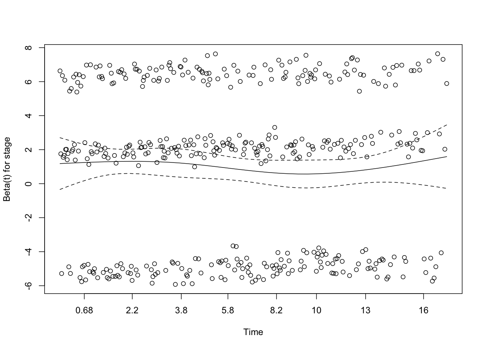
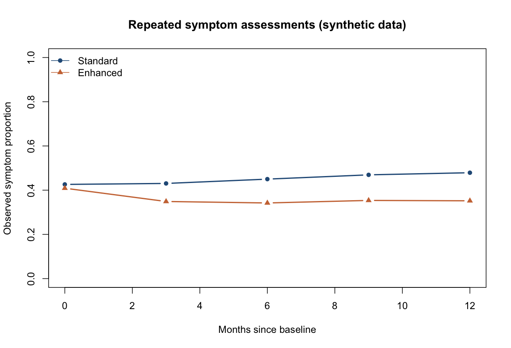

```{r setup, include=FALSE}
knitr::opts_chunk$set(echo = FALSE, warning = FALSE, message = FALSE)
stopifnot(file.exists("../outputs/tables/data_quality_summary.csv"))
read_table <- function(name) utils::read.csv(file.path("../outputs/tables", name), check.names = FALSE)
```

# Résumé / Summary {#summary}

**FR —** Ce rapport illustre plusieurs méthodes utilisées en biostatistique et en études fondées sur les données de vie réelle (RWE), à partir d'une **cohorte entièrement synthétique de 900 patients**. Le projet est pédagogique : il ne s'agit pas d'une étude clinique et les estimations ne doivent pas guider des décisions médicales.

**EN —** This report demonstrates methods used in biostatistics and Real-World Evidence (RWE) studies using a **fully synthetic cohort of 900 patients**. It is an educational demonstration, not a clinical study; estimates must not guide medical decisions.

**FR —** Les analyses s'inspirent des travaux de Master 2 en santé publique portant sur l'analyse de survie, les modèles de régression et les données longitudinales. Le protocole méthodologique figure dans le [plan d'analyse statistique](../docs/statistical_analysis_plan.md).

**EN —** The analyses build on MSc Public Health coursework in survival analysis, regression and longitudinal modelling. See the [statistical analysis plan](../docs/statistical_analysis_plan.md) for the detailed methodology.

# Qualité des données / Data quality {#data-quality}

**FR —** Vérifications des identifiants, de la cohérence du suivi et des valeurs manquantes avant les analyses.  
**EN —** Checks of identifiers, follow-up consistency and missing values before the analyses.

```{r qc}
knitr::kable(read_table("data_quality_summary.csv"), digits = 3,
             caption = "Contrôles qualité / Data quality checks")
```

# Kaplan-Meier et log-rank / Kaplan–Meier and log-rank {#survival-analysis}

**FR —** Les courbes de Kaplan-Meier décrivent la probabilité de rester sans événement au cours du suivi selon le groupe de traitement simulé. Le test du log-rank compare les courbes sans ajustement sur les covariables.  
**EN —** Kaplan–Meier curves describe event-free survival over follow-up by simulated treatment group. The log-rank test compares the curves without covariate adjustment.

```{r km-figure, fig.cap="Courbes de Kaplan-Meier / Kaplan–Meier curves", out.width='90%'}
knitr::include_graphics("../outputs/figures/kaplan_meier.png")
```

```{r logrank-table}
knitr::kable(read_table("logrank_test.csv"), digits = 4,
             caption = "Test du log-rank / Log-rank test")
```

**FR —** Une différence observée dans ces données fictives ne démontre pas un effet causal du traitement.  
**EN —** An observed difference in these fictional data does not demonstrate a causal treatment effect.

# Modèle de Cox ajusté / Adjusted Cox regression {#cox-regression}

**FR —** Le modèle de Cox estime des hazard ratios ajustés. Le modèle stratifie le risque de base par centre et tient compte du groupe de traitement, de l'âge et du stade clinique.  
**EN —** The Cox model estimates adjusted hazard ratios. Baseline hazards are stratified by centre, with treatment group, age and clinical stage included as covariates.

```{r cox-table}
knitr::kable(read_table("cox_hazard_ratios.csv"), digits = 3,
             caption = "Hazard ratios ajustés / Adjusted hazard ratios")
```

**FR —** L'hypothèse des risques proportionnels est examinée avec les résidus de Schoenfeld et la fonction `cox.zph()`. Un test non significatif ne démontre pas à lui seul que l'hypothèse est satisfaite.  
**EN —** Proportional hazards are assessed with Schoenfeld residuals using `cox.zph()`. A non-significant test alone does not prove the assumption holds.

```{r cox-diagnostics-table}
knitr::kable(read_table("cox_ph_assumptions.csv"), digits = 3,
             caption = "Diagnostics des risques proportionnels / Proportional-hazards diagnostics")
```

```{r cox-figure, fig.cap="Diagnostics de Schoenfeld / Schoenfeld diagnostics", out.width='90%'}

```

# Régression logistique à 12 mois / Logistic regression at 12 months {#logistic-regression}

**FR —** Une régression logistique multivariée modélise la survenue d'un événement avant 12 mois parmi les personnes dont le statut à 12 mois peut être déterminé. Les personnes censurées sans événement avant 12 mois sont exclues, ce qui peut introduire un biais de sélection.  
**EN —** Multivariable logistic regression models an event by month 12 among participants whose 12-month event status is known. Participants censored event-free before month 12 are excluded, potentially introducing selection bias.

```{r logistic-eligible}
knitr::kable(read_table("logistic_model_summary.csv"), digits = 3,
             caption = "Population évaluable et performance / Evaluable population and performance")
```

```{r logistic-table}
knitr::kable(read_table("logistic_odds_ratios.csv"), digits = 3,
             caption = "Odds ratios ajustés / Adjusted odds ratios")
```

# Symptômes répétés : GLMM / Repeated symptoms: GLMM {#longitudinal-glmm}

**FR —** Un modèle logistique mixte (GLMM) à intercept aléatoire par patient tient compte de la corrélation des observations répétées. L'âge est centré et exprimé par tranche de dix ans (`age_10`) pour améliorer le comportement numérique de l'ajustement. Les OR sont conditionnels au modèle et ne correspondent pas à des OR marginaux GEE.  
**EN —** A patient-level random-intercept logistic GLMM accounts for correlated repeated observations. Age is centred and scaled per ten years (`age_10`) to improve numerical stability. The reported odds ratios are conditional model estimates and are not marginal GEE odds ratios.

```{r glmm-figure, fig.cap="Proportions observées de symptômes / Observed symptom proportions", out.width='90%'}

```

```{r glmm-table}
knitr::kable(read_table("glmm_conditional_odds_ratios.csv"), digits = 3,
             caption = "Odds ratios conditionnels du GLMM / GLMM conditional odds ratios")
```

**FR —** Seules les mesures observées pendant le suivi sont utilisées. Les résultats doivent être interprétés dans le cadre des règles de simulation.  
**EN —** Only symptom observations available during follow-up are analysed. Results must be interpreted within the simulation framework.

# Limites et éthique / Limitations and ethics {#limitations}

**FR —** Les données sont entièrement simulées. L'absence de randomisation, les biais potentiels de sélection et les valeurs manquantes empêchent toute interprétation causale. Ce projet n'effectue ni ajustement par scores de propension, ni imputation multiple, ni analyse des risques concurrents. Aucun résultat n'est généralisable à des patients réels.  
**EN —** All data are simulated. Non-random treatment assignment, potential selection bias and missing values preclude causal interpretation. This demonstration does not implement propensity-score adjustment, multiple imputation or competing-risk analysis. Findings cannot be generalised to real patients.

**FR / EN —** Code et documentation / Code and documentation : [README](../README.md) · [SAP](../docs/statistical_analysis_plan.md) · [Dictionnaire / Data dictionary](../docs/data_dictionary.md)
