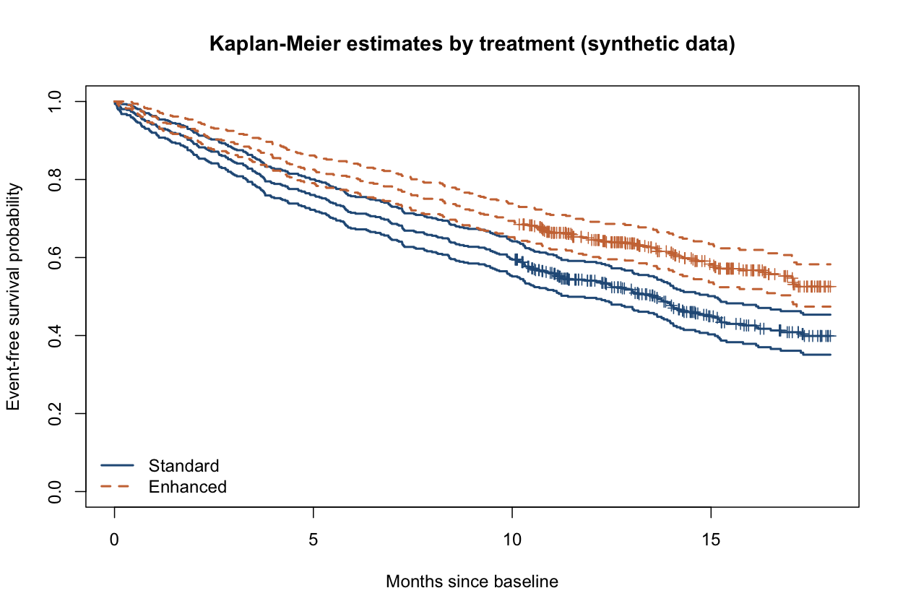

```{r setup, include=FALSE}
knitr::opts_chunk$set(echo = FALSE, warning = FALSE, message = FALSE)
stopifnot(file.exists("../outputs/tables/data_quality_summary.csv"))
read_table <- function(name) utils::read.csv(file.path("../outputs/tables", name), check.names = FALSE)
```

# Summary

This is an **educational RWE methodology demonstration using entirely synthetic patient data**. It is not a real clinical study, and none of the estimates can guide healthcare decisions.

The analysis draws on MSc-level coursework covering survival analysis, regression and longitudinal mixed-effects modelling. The detailed methodology and assumptions are in `docs/statistical_analysis_plan.md`.

# Data quality

```{r qc}
knitr::kable(read_table("data_quality_summary.csv"), digits = 3)
```

# Kaplan-Meier and log-rank test

```{r km-figure, out.width='90%'}

```

```{r logrank-table}
knitr::kable(read_table("logrank_test.csv"), digits = 4)
```

The log-rank test is unadjusted. Differences between treatment groups in these simulated observational data must not be interpreted causally.

# Adjusted Cox model

```{r cox-table}
knitr::kable(read_table("cox_hazard_ratios.csv"), digits = 3)
```

```{r cox-diagnostics-table}
knitr::kable(read_table("cox_ph_assumptions.csv"), digits = 3)
```

```{r cox-figure, out.width='90%'}
knitr::include_graphics("../outputs/figures/cox_schoenfeld.png")
```

A non-significant Schoenfeld-residual test does not establish that proportional hazards are definitively satisfied.

# Logistic regression at month 12

```{r logistic-eligible}
knitr::kable(read_table("logistic_model_summary.csv"), digits = 3)
```

```{r logistic-table}
knitr::kable(read_table("logistic_odds_ratios.csv"), digits = 3)
```

The analysis excludes patients censored event-free before month 12 because their outcome is unobserved. This can introduce selection bias.

# Repeated symptoms: logistic GLMM

```{r glmm-figure, out.width='90%'}
knitr::include_graphics("../outputs/figures/observed_symptom_rates.png")
```

```{r glmm-table}
knitr::kable(read_table("glmm_conditional_odds_ratios.csv"), digits = 3)
```

These are model-based **conditional**, not marginal, odds ratios. Symptom measurements are only included while participants remain under observation.

# Limitations

The data are simulated; there is no causal identification, no real-world generalisability and no clinical validation. The initial demonstration does not implement propensity-score adjustment, imputation or competing-risk estimation. Review the SAP and code before drawing methodological conclusions.
